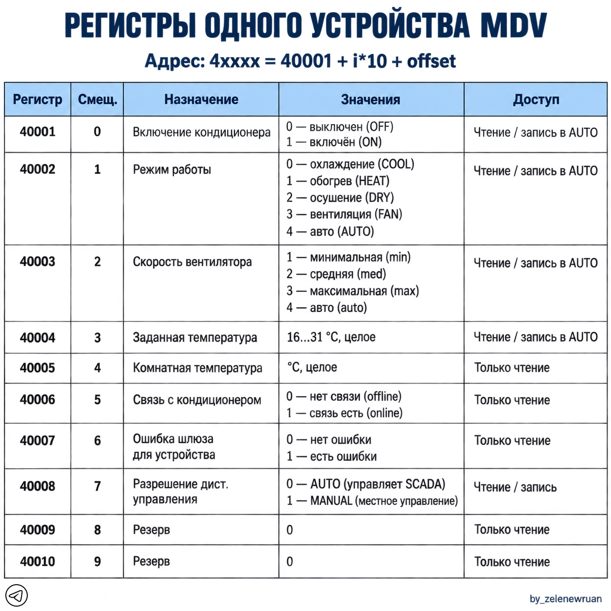

# MDV Gateway XYE

Шлюз для кондиционеров MDV/Lessar: опрашивает устройства по RS485, предоставляет их состояние через Modbus TCP и передаёт команды управления из Modbus обратно в шину. Реализация написана на Go как перенос ранее существовавшего скрипта Python 2.7. В каталоге находится только Go-версия; исходного Python-скрипта здесь нет.

## Состав проекта

| Файл | Назначение |
| --- | --- |
| `mdv_gateway.go` | Весь исходный код: конфигурация, протокол MDV, последовательный порт, Modbus TCP, цикл опроса и логирование. |
| `go.mod` | Модуль `mdv_gateway`, версия Go `1.27.1`. Сторонних Go-модулей нет. |
| `config.json` | Пример рабочей конфигурации: `/dev/ttyUSB0`, 4800 бод, адреса 0–3, сервер на порту 502. |
| `build.bat` | Сборка из Windows под Linux ARMv7, ARM64 и x86-64. |
| `mdv_gateway` | Готовый исполняемый файл Linux ARMv7 (по метаданным `go version -m`), собранный с `CGO_ENABLED=0`. |
| `карта.png` | Наглядная карта десяти регистров одного устройства. |

## Как работает шлюз

```text
SCADA / Modbus TCP-клиент
          │ FC03, FC06, FC16
          ▼
 Modbus TCP-сервер ── общая таблица регистров ── RS485-воркер
                                                │ опрос C0 / команда C3
                                                ▼
                                      MDV/Lessar на шине RS485
```

При запуске программа читает `config.json`, создаёт по 10 holding-регистров на каждый элемент `devices`, запускает TCP-сервер в отдельной горутине и затем выполняет цикл RS485 в основной горутине. Первое успешное чтение устройства инициализирует его управляющие значения; до этого регистры имеют нулевые значения. В каждом следующем цикле воркер сначала проверяет ожидающие команды, потом последовательно опрашивает все устройства. Фиксированной паузы между полными циклами нет: скорость зависит от числа устройств и времени ответа шины.

TCP-сервер обслуживает отдельные клиентские соединения в горутинах. Таблица регистров защищена mutex; записи клиентов дополнительно отмечаются счётчиком поколений, чтобы не потерять новую команду во время обработки старой. Все устройства используют **один** диапазон регистров, независимо от Unit ID в заголовке Modbus TCP: сервер возвращает полученный Unit ID, но не использует его для выбора кондиционера.

## Требования, сборка и запуск

- Целевая система: Linux, архитектура ARMv7, ARM64 или amd64. Работа с портом использует Linux `termios`, `ioctl`, `select` и системные вызовы; запуск исходника непосредственно в Windows не предусмотрен.
- Для сборки из исходника нужен Go 1.27.1 согласно `go.mod` и доступный компилятору кэш. Внешние библиотеки не требуются.
- Нужны адаптер RS485, доступ к настроенному последовательному устройству и возможность слушать выбранный TCP-порт. Для стандартного порта 502 в Linux обычно нужны соответствующие права или capability `CAP_NET_BIND_SERVICE`.

Из Windows выполните `build.bat`. Скрипт выставляет `CGO_ENABLED=0`, `GOOS=linux` и по очереди собирает `mdv_gateway_arm7`, `mdv_gateway_arm64`, `mdv_gateway_amd64` с флагами `-ldflags="-s -w"`. Скрипт печатает `OK` после команды сборки без проверки её кода возврата; наличие и пригодность файлов результата следует проверить отдельно.

Пример сборки на Linux для текущей архитектуры:

```sh
go build -o mdv_gateway mdv_gateway.go
```

Поместите `config.json` рядом с исполняемым файлом и запустите:

```sh
chmod +x ./mdv_gateway
./mdv_gateway
```

Первый аргумент командной строки позволяет указать другой файл конфигурации: `./mdv_gateway /path/to/config.json`. Без аргумента путь определяется по расположению самого исполняемого файла, а не по текущему рабочему каталогу. При ошибке чтения конфигурации программа завершается с кодом 1. Если TCP-порт занят или недоступен, сервер пишет ошибку, но RS485-воркер продолжает работать; доступность Modbus нужно проверять по логу или подключением клиента.

## Конфигурация

Текущий `config.json`:

```json
{
  "serial": {"port": "/dev/ttyUSB0", "baudrate": 4800},
  "devices": [{"address": 0}, {"address": 1}, {"address": 2}, {"address": 3}],
  "modbus": {"host": "0.0.0.0", "port": 502},
  "log_level": "warning"
}
```

| Поле | Смысл |
| --- | --- |
| `serial.port` | Путь к устройству Linux, например `/dev/ttyUSB0`. Обязательное непустое поле. |
| `serial.baudrate` | Скорость последовательного порта. Поддерживаются 300, 600, 1200, 2400, 4800, 9600, 19200, 38400, 57600, 115200, 230400, 460800 и 921600 бод. По умолчанию в примере — 4800. |
| `devices[].address` | Адрес кондиционера в протоколе MDV. Список не может быть пустым; адреса уникальны и проверяются в диапазоне 0–64. Верхняя граница в коде условная и требует сверки с документацией конкретной серии. Порядок в списке задаёт порядок блоков Modbus. |
| `modbus.host` | Интерфейс прослушивания TCP; `0.0.0.0` означает все интерфейсы. |
| `modbus.port` | TCP-порт; значение 0 отклоняется при загрузке конфигурации. |
| `log_level` | `debug`, `info`, `warning`, `error` без учёта регистра. Любое другое значение выбирает `warning`. |

Числовые поля принимают JSON-число или строку с целым числом. Последовательный порт настраивается как 8 бит данных, без чётности и стоп-бита сверх одного (8N1), без аппаратного управления потоком.

## Карта Modbus-регистров

Для устройства с **индексом** `i` в массиве `devices` (начиная с 0) отображаемый адрес равен `40001 + 10 × i + смещение`. Например, устройство с MDV-адресом 2 в текущей конфигурации имеет индекс 2 и блок `40021–40030`. MDV-адрес сам по себе не определяет номер регистра.

| Смещение | Первое устройство | Значение | Доступ |
| ---: | ---: | --- | --- |
| 0 | 40001 | Питание: 0 — выключен, 1 — включён | Чтение, запись в AUTO |
| 1 | 40002 | Режим: 0 — охлаждение, 1 — обогрев, 2 — осушение, 3 — вентиляция, 4 — авто | Чтение, запись в AUTO |
| 2 | 40003 | Скорость: 1 — минимум, 2 — средняя, 3 — максимум, 4 — авто | Чтение, запись в AUTO |
| 3 | 40004 | Уставка температуры: целое число 16–31 °C | Чтение, запись в AUTO |
| 4 | 40005 | Температура помещения: целое число °C | Чтение |
| 5 | 40006 | Связь: 0 — offline, 1 — online | Чтение |
| 6 | 40007 | Ошибка шлюза: в текущем коде устанавливается только 0 при успешном опросе | Чтение |
| 7 | 40008 | Режим управления: 0 — AUTO, 1 — MANUAL | Чтение, запись |
| 8–9 | 40009–40010 | Резерв, исходное значение 0 | Чтение |

Указанные `4xxxx` — человекочитаемые номера holding-регистров. В запросе Modbus TCP обычно передаётся **нулевой адрес**: для 40001 это 0, для 40008 — 7, для 40021 — 20. Реализация также принимает в поле адреса число 40001 и преобразует его в индекс 0, однако совместимость конкретного клиента следует настраивать по его собственному соглашению об адресации. Отрицательная комнатная температура при чтении передаётся как 16-битное значение в дополнительном коде; клиенту может потребоваться интерпретация `int16`.

Поддерживаемые функции Modbus: **FC03** (чтение holding-регистров, 1–125), **FC06** (запись одного регистра) и **FC16** (запись нескольких, 1–123). Для выхода за диапазон возвращается exception `0x02`, для недопустимого количества — `0x03`, для другой функции — `0x01`. Значение `32768` (`0x8000`) в регистрах 0–3 при записи означает «не менять»; на регистр режима управления это правило не распространяется. Недопустимое значение конкретного регистра пропускается, но корректно оформленный запрос всё равно подтверждается обычным ответом функции — клиенту следует затем прочитать регистры для проверки результата.

**Особенность текущей реализации:** в режиме MANUAL одиночная запись FC06 в регистры 0–3 игнорируется. Обработка FC16 не проверяет MANUAL и может временно изменить эти значения в таблице; отправка команды C3 всё равно блокируется воркером. Для безопасной работы клиента в MANUAL не используйте FC16 для управляющих регистров, пока эта логика не будет исправлена.

## RS485 и логика управления

- Опрос отправляет пакет MDV `C0`; команда управления — `C3`. Для команды формируется контрольная сумма исходящего пакета. Ответ принимается при наличии нужного заголовка, типа команды, адреса и завершающего байта; **контрольная сумма входящего ответа не проверяется**, поскольку её алгоритм для реального оборудования в коде не подтверждён.
- Для 4800 бод таймаут ответа опроса и управления составляет 250 мс, пауза для определения конца пакета — 25 мс, максимум ответа — 64 байта. Перед запросом входной буфер порта очищается.
- Команда отправляется только после успешной инициализации устройства, при отличии управляющих регистров от последнего принятого состояния, не чаще одного раза в 1,5 секунды и если с последнего успешного опроса прошло не более 30 секунд.
- Если три команды подряд не получили подтверждения, попытки прекращаются и регистры 0–3 возвращаются к последнему состоянию. Новая запись Modbus разрешает следующую попытку. После пяти неудачных опросов подряд `online` становится 0; успешный опрос восстанавливает 1.
- В AUTO изменения на самом кондиционере принимаются после двух одинаковых опросов за пределами шестисекундного защитного окна после команды. Это помогает отличать локальное управление от ещё не подтвердившегося изменения SCADA.
- Запись 1 в регистр смещения 7 переводит конкретное устройство в MANUAL: опрос и обновление температуры/связи продолжаются, а команды C3 от SCADA не отправляются. При возврате 0 в AUTO воркер восстанавливает сохранённые перед обслуживанием значения SCADA, если они были корректны, и снова может передать их на кондиционер.
- При исчезновении или ошибке порта воркер пытается открыть его повторно с задержкой 5–20 секунд и заново инициализирует устройства. Порт дополнительно проверяется через `TCGETS` каждые десять циклов.

## Логи и диагностика

Лог пишется в `mdv_gateway.log` рядом с исполняемым файлом; если файл открыть не удалось, используется stderr. При достижении 512 КиБ файл ротируется, сохраняются `.1` и `.2`. Сообщения уровня ERROR дополнительно выводятся в stderr. Предупреждения некоторых повторяющихся ошибок ограничены частотой один раз в 60 секунд на тип ошибки и устройство. Для наблюдения за пакетами RS485 установите `"log_level": "debug"`, для состояния устройств и операций Modbus — `"info"`.

## Известные ограничения

- В каталоге нет автоматических тестов, спецификации протокола конкретной серии MDV и эталонных ответов оборудования. Фактическую совместимость и корректность команд нужно проверять на целевой шине.
- `regError` (смещение 6) зарезервирован в карте, но текущий код не устанавливает его в 1 при ошибках. Для оценки связи используйте `regOnline` и лог.
- Проверка формата Modbus TCP минимальна: сервер не валидирует Protocol ID, не ограничивает явно длину MBAP и не задаёт таймаут клиентского чтения. Размещайте его в доверенной сети или защищайте сетевым доступом.
- В `build.bat` нет остановки при ошибке компиляции; проверяйте код возврата и полученные бинарники перед развертыванием.

Схема регистров из каталога: .
